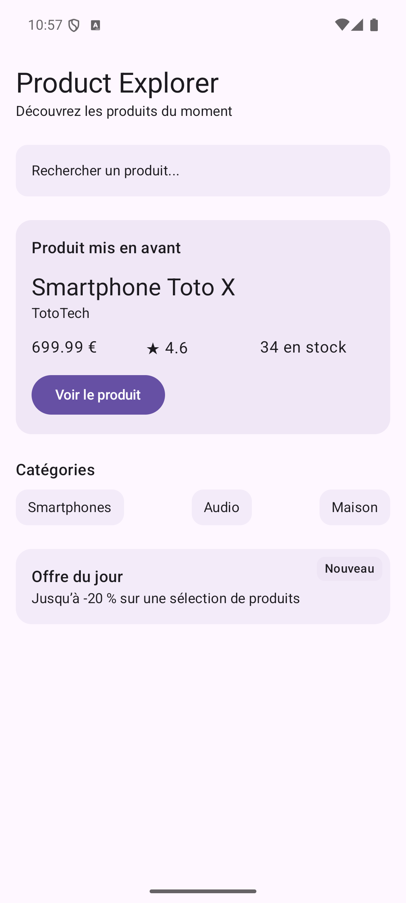

# Product Explorer

Application Android en Jetpack Compose réalisée pendant le bloc 2 du cours (TP 4 et 5).
Les données sont locales : aucun appel réseau pour l'instant.

## TP 4 – Écran de détail produit

`ProductDetailScreen` assemble une image, un en-tête, une carte de prix, la note, une carte de disponibilité, la description, la garantie et un bouton d'action.

Composants utilisés : `Text`, `Button`, `Icon`, `Image`, `Card`, `OutlinedTextField`, previews.

## TP 5 – Écran d'accueil

`ProductHomeScreen` est affiché au lancement et assemble un en-tête, une barre de recherche visuelle, le produit mis en avant, les catégories et l'offre du jour.

Layouts utilisés : `Column`, `Row`, `Box`, `Spacer`, `Surface`.
